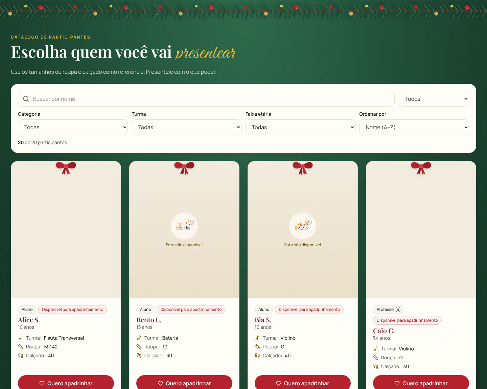
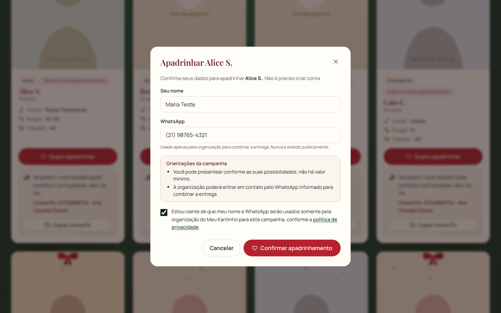
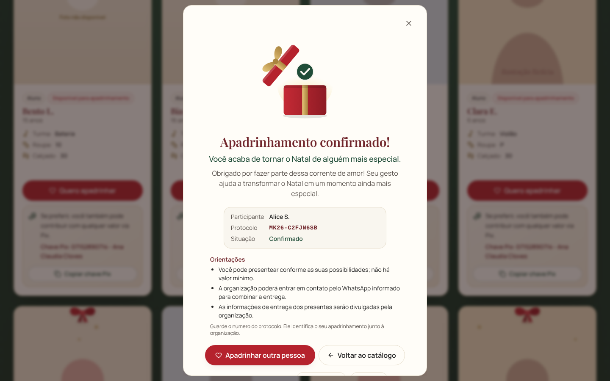
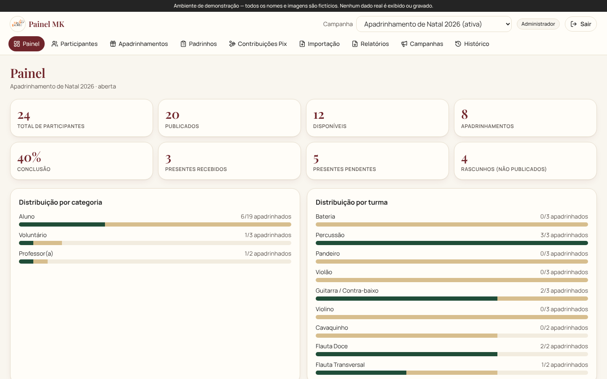
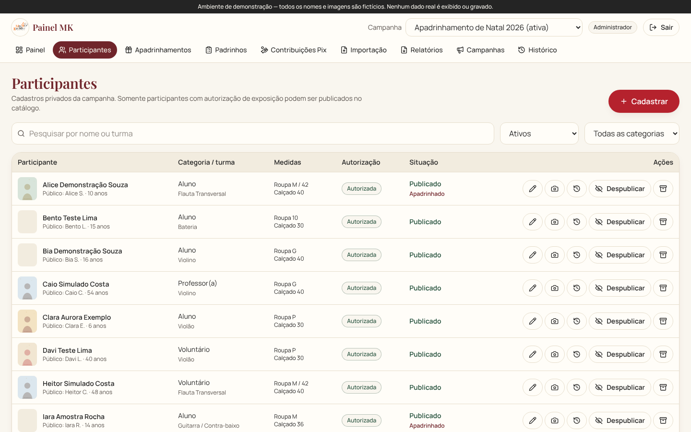
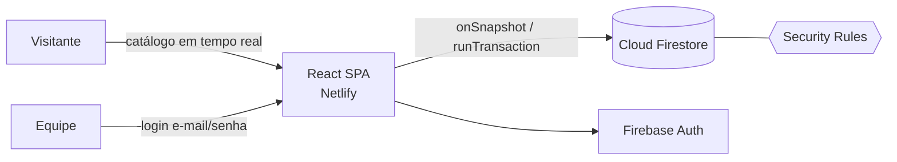

# 🎄 Apadrinhamento MK 2.0: Natal 2026

**Plataforma de apadrinhamento de Natal do Meu Kantinho Centro de Cultura**, um projeto social de música no Rio de Janeiro.
Pessoas da comunidade escolhem um aluno, professor ou voluntário no catálogo e se comprometem a presenteá-lo. A organização acompanha tudo por um painel administrativo.

**🔗 No ar:** [natal-meukantinho.netlify.app](https://natal-meukantinho.netlify.app)


> Todas as imagens deste README foram feitas no **modo de demonstração**, com nomes e fotos fictícios. Nenhum dado real de participante é exibido aqui.

---

## O problema

A campanha de 2025 funcionava com um site estático simples. Ele tinha alguns problemas:
- **Duas pessoas podiam apadrinhar o mesmo participante** ao mesmo tempo.
- Dados pessoais (como telefones de padrinhos) ficavam **legíveis pela internet**, por causa de regras do banco muito abertas.
- A equipe precisava **copiar e colar** os dados do Google Forms no banco, um por um.
- A organização não tinha um **painel** para acompanhar entregas, contribuições e relatórios.

## A solução

Reescrevi a plataforma do zero, com foco em **confiabilidade, privacidade e facilidade para uma equipe não técnica**:

| | |
|---|---|
| 🔒 **Apadrinhamento atômico** | Transação no Firestore e regras de segurança no servidor garantem que, com duas confirmações simultâneas, **só uma é aceita**. Funciona sem login para o padrinho. |
| 🛡️ **Privacidade por design** | Os dados públicos e os privados ficam em coleções separadas. O telefone do padrinho **nunca** sai da área administrativa, e o participante só aparece no site com autorização registrada. |
| 📥 **Importação do Google Forms** | O painel lê a planilha (.xlsx/.csv), filtra só as respostas do ano, padroniza os nomes, detecta duplicados e **liga cada foto à pessoa** a partir do .zip baixado do Google Drive. |
| 🧑‍💼 **Painel `/admin`** | Perfis de administrador e operador; participantes, fotos, apadrinhamentos (com fluxo de status), padrinhos, contribuições Pix, campanhas, relatórios em Excel/CSV e histórico de auditoria que não pode ser apagado. |
| ✨ **Experiência natalina** | Abertura animada (o Papai Noel sobe a árvore e a estrela acende), neve, guirlandas e uma **celebração em tela cheia** quando o apadrinhamento é confirmado. Tudo respeita o "reduzir movimento" do sistema. |
| 📱 **Responsivo e acessível** | De 320 px a 1920 px, com navegação por teclado, foco visível e textos alternativos (meta: WCAG 2.2 AA). |

## Telas

| Catálogo | Apadrinhar |
|---|---|
|  |  |

| Celebração da confirmação | Confirmação com protocolo |
|---|---|
|  |  |

| Painel administrativo | Gestão de participantes |
|---|---|
|  |  |

<p align="center">&nbsp;&nbsp;&nbsp;</p>

## Arquitetura



- **Sem servidor próprio:** roda no plano gratuito do Firebase (Spark) e do Netlify. Toda a regra de negócio crítica fica nas **Security Rules**, testadas no emulador.
- **Camada de dados abstraída** (`DataService`): há uma implementação para o Firebase e outra de **demonstração** (localStorage + BroadcastChannel). A demonstração permite rodar o site inteiro e os testes de ponta a ponta sem backend.
- **Fotos tratadas no navegador:** redimensionadas, comprimidas e **sem metadados EXIF/GPS** antes do envio.
- **Planilhas exportadas com proteção** contra injeção de fórmulas (CSV/Excel).

Mais detalhes em [docs/ARQUITETURA.md](docs/ARQUITETURA.md).

## Testes

| Tipo | Ferramenta | Resultado |
|---|---|---|
| Unitários e de componentes | Vitest + Testing Library | **42 aprovados** |
| Ponta a ponta (8 larguras de tela, de 320 a 1920 px) | Playwright | **31 aprovados** |
| Regras de segurança | Firebase Emulator + `@firebase/rules-unit-testing` | **17 aprovados** |

Os testes das regras cobrem, entre outros: corrida entre dois apadrinhamentos simultâneos, tentativa de forjar um apadrinhamento, campanha em rascunho ou encerrada, permissões de operador e de administrador, e o histórico de auditoria que só aceita novos registros. Veja as evidências em [evidence/TESTES.md](evidence/TESTES.md).

## Rodando localmente

Requisitos: **Node.js 24 LTS**. Para os testes de regras, também **Java 21+**.

```bash
npm ci
npm run dev:demo      # site completo com dados fictícios, sem Firebase
# painel: /admin  →  admin@demo.mk / demo-admin  ·  operador@demo.mk / demo-operador
```

| Script | O que faz |
|---|---|
| `npm run dev` | Desenvolvimento com Firebase (copie `.env.example` para `.env.local`) |
| `npm run build` | Build de produção |
| `npm test` | Testes unitários e de componentes |
| `npm run test:e2e` | Testes de ponta a ponta (Playwright) |
| `npm run test:rules` | Regras de segurança no Firebase Emulator |

## Estrutura

```
src/
  components/     cards, formulário, animações, decoração natalina
  pages/          site público e painel /admin
  services/data/  DataService (Firebase e demonstração)
  services/       importação de planilhas, fotos, relatórios
  lib/            telefone, nomes, protocolo, filtros, permissões
firestore.rules   regras de segurança (testadas em tests/rules)
tests/            e2e (Playwright) e regras (emulador)
docs/             arquitetura, implantação, manual da equipe
```

## Documentação

- [Arquitetura e modelo de dados](docs/ARQUITETURA.md)
- [Implantação passo a passo](docs/IMPLANTACAO.md)
- [Manual da equipe (painel)](docs/MANUAL-ADMIN.md)
- [Auditoria da versão 2025](docs/AUDITORIA.md)

## Autor

**Bruno Pessino**: estudante de Engenharia de Software na UVA.
[GitHub](https://github.com/brunopessino) · [LinkedIn](https://linkedin.com/in/brunopessino)

Projeto feito para o **Meu Kantinho Centro de Cultura**, fundado em 1998 por Cloves do Violão · [site](https://www.meukantinho.com.br/) · [Instagram](https://www.instagram.com/meukantinho_oficial/).
A versão de 2025 está em [brunopessino/apadrinhamento-mk](https://github.com/brunopessino/apadrinhamento-mk).
